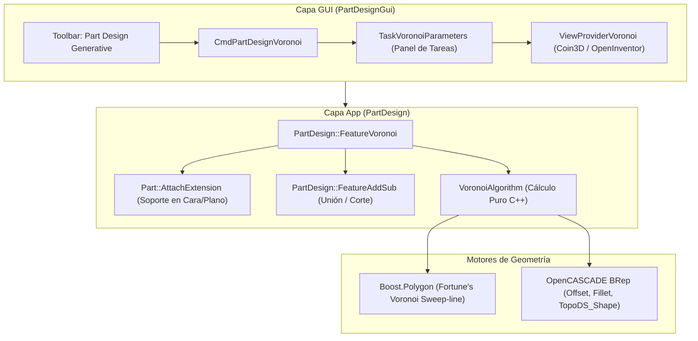
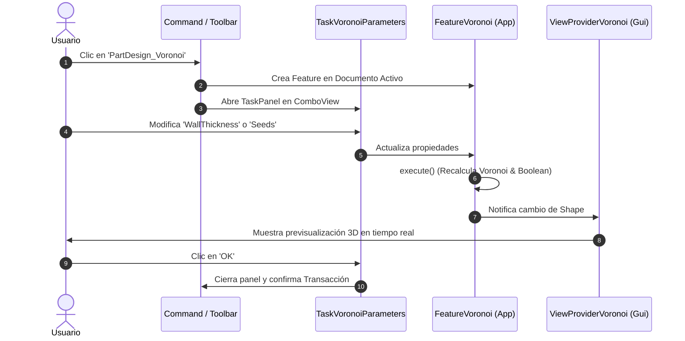

# Guía de Arquitectura e Implementación: Feature de Voronoi en FreeCAD PartDesign (C++)

Este documento describe la arquitectura, diseño de algoritmos, código fuente y configuración de compilación para implementar una funcionalidad nativa y paramétrica de generación de **estructuras de Voronoi 2.5D (Aditivas y Sustractivas)** dentro del módulo **PartDesign** de FreeCAD.

---

## 1. Resumen y Decisiones de Arquitectura

### 1.1 ¿Por qué una Feature Nativa en C++ y no un Sketch?
* **Rendimiento Escalable:** Una estructura de Voronoi típica contiene entre 30 y 300 celdas. Modelar esto como un boceto (`Sketcher::SketchObject`) genera cientos de restricciones geométricas que saturan el solver de Sketcher (Eigen/GPL) y congelan la interfaz.
* **Integración Paramétrica:** Al heredar de `PartDesign::FeatureAddSub` y `Part::AttachExtension`, la operación se comporta igual que un *Pad* o un *Pocket*, fusionando (aditivo: nervaduras) o cortando (sustractivo: aligeramiento) el sólido del `PartDesign::Body` de forma automática.
* **Librerías Disponibles:** FreeCAD ya enlaza **Boost** de forma estándar en el núcleo. Se utiliza `boost::polygon::voronoi.hpp` (implementación del algoritmo de barrido de Fortune con aritmética exacta), que ofrece una complejidad temporal de $O(N \log N)$ y previene inconsistencias numéricas.



---

## 2. Fase 1: Núcleo Matemático y Algorítmico (`VoronoiAlgorithm`)

### 2.1 Principios del Algoritmo
1. **Generación de Semillas Homogéneas:** En lugar de una distribución aleatoria pura (ruido blanco), se utiliza una cuadrícula perturbada (*Jittered Grid*) o muestreo por disco de Poisson (*Poisson Disk Sampling*) para garantizar celdas estéticas y estructuralmente viables.
2. **Escalado a Enteros para Boost:** `boost::polygon::construct_voronoi` requiere o recomienda coordenadas enteras (`int32_t` o `int64_t`) para mantener predicados geométricos exactos. Las coordenadas milimétricas se escalan por un factor (ej. $K = 10^4$).
3. **Offset de Paredes:** Cada celda poligonal resultante se contrae internamente mediante `BRepOffsetAPI_MakeOffset` a una distancia de `WallThickness / 2.0`.
4. **Construcción B-Rep:** Se transforman los alambres resultantes en `TopoDS_Face`, se combinan en un compuesto y se extruyen a lo largo de la normal de la cara con `BRepPrimAPI_MakePrism`.

### 2.2 `src/Mod/PartDesign/App/VoronoiAlgorithm.h`
```cpp
// SPDX-License-Identifier: LGPL-2.1-or-later
#pragma once

#include <vector>
#include <gp_Pnt2d.hxx>
#include <TopoDS_Face.hxx>
#include <TopoDS_Shape.hxx>
#include <Mod/PartDesign/PartDesignGlobal.h>

namespace PartDesign
{

struct VoronoiParams
{
    int numPoints {50};             // Cantidad aproximada de semillas
    double wallThickness {2.0};     // Espesor de la nervadura/pared (mm)
    double filletRadius {1.0};      // Radio de redondeo en vértices de celdas (mm)
    double depth {5.0};             // Altura o profundidad de extrusión (mm)
    int randomSeed {1234};          // Semilla para reproducibilidad
    double width {100.0};           // Ancho del dominio 2D (mm)
    double height {100.0};          // Alto del dominio 2D (mm)
};

class PartDesignExport VoronoiAlgorithm
{
public:
    VoronoiAlgorithm() = default;

    /// Genera la forma sólida 3D de la estructura de Voronoi
    static TopoDS_Shape generateVoronoiPrism(const VoronoiParams& params);

    /// Genera los puntos de muestreo en el dominio 2D
    static std::vector<gp_Pnt2d> generateSeeds(const VoronoiParams& params);

private:
    static const int CoordinateScale = 10000; // Factor de escala para Boost
};

} // namespace PartDesign
```

### 2.3 `src/Mod/PartDesign/App/VoronoiAlgorithm.cpp`
```cpp
// SPDX-License-Identifier: LGPL-2.1-or-later
#include "VoronoiAlgorithm.h"

#include <random>
#include <cmath>
#include <map>
#include <vector>

#include <boost/polygon/voronoi.hpp>

#include <BRepBuilderAPI_MakeEdge.hxx>
#include <BRepBuilderAPI_MakeWire.hxx>
#include <BRepBuilderAPI_MakeFace.hxx>
#include <BRepOffsetAPI_MakeOffset.hxx>
#include <BRepPrimAPI_MakePrism.hxx>
#include <BRep_Builder.hxx>
#include <TopoDS_Compound.hxx>
#include <gp_Pln.hxx>
#include <gp_Vec.hxx>
#include <Geom_Plane.hxx>
#include <Geom2d_Line.hxx>
#include <Geom2d_TrimmedCurve.hxx>
#include <ChFi2d_AnaFilletAlgo.hxx>

using namespace PartDesign;

std::vector<gp_Pnt2d> VoronoiAlgorithm::generateSeeds(const VoronoiParams& params)
{
    std::vector<gp_Pnt2d> points;
    if (params.numPoints <= 0) return points;

    std::mt19937 rng(params.randomSeed);
    std::uniform_real_distribution<double> dist(-0.4, 0.4);

    // Muestreo estratificado (Jittered Grid) para distribución homogénea
    int cols = static_cast<int>(std::ceil(std::sqrt(params.numPoints * (params.width / params.height))));
    if (cols < 1) cols = 1;
    int rows = static_cast<int>(std::ceil(static_cast<double>(params.numPoints) / cols));
    if (rows < 1) rows = 1;

    double dx = params.width / cols;
    double dy = params.height / rows;

    for (int i = 0; i < cols; ++i) {
        for (int j = 0; j < rows; ++j) {
            if (static_cast<int>(points.size()) >= params.numPoints) break;
            double jitterX = dist(rng) * dx;
            double jitterY = dist(rng) * dy;
            double x = (i + 0.5) * dx + jitterX;
            double y = (j + 0.5) * dy + jitterY;
            points.emplace_back(x, y);
        }
    }
    return points;
}

TopoDS_Shape VoronoiAlgorithm::generateVoronoiPrism(const VoronoiParams& params)
{
    using namespace boost::polygon;

    std::vector<gp_Pnt2d> seeds = generateSeeds(params);
    if (seeds.size() < 3) return TopoDS_Shape();

    // 1. Escalar semillas para Boost.Polygon
    std::vector<point_data<int32_t>> boostPoints;
    boostPoints.reserve(seeds.size());
    for (const auto& pt : seeds) {
        boostPoints.emplace_back(
            static_cast<int32_t>(pt.X() * CoordinateScale),
            static_cast<int32_t>(pt.Y() * CoordinateScale)
        );
    }

    // 2. Construir el diagrama de Voronoi
    voronoi_diagram<double> vd;
    construct_voronoi(boostPoints.begin(), boostPoints.end(), &vd);

    // 3. Reconstruir polígonos por celda (filtrando celdas abiertas en el infinito)
    TopoDS_Compound compoundFaces;
    BRep_Builder builder;
    builder.MakeCompound(compoundFaces);

    double halfWall = params.wallThickness / 2.0;

    for (const auto& cell : vd.cells()) {
        const voronoi_diagram<double>::edge_type* edge = cell.incident_edge();
        if (!edge) continue;

        bool hasInfinite = false;
        std::vector<gp_Pnt2d> polyPoints;
        const voronoi_diagram<double>::edge_type* curr = edge;

        do {
            if (curr->is_infinite() || !curr->vertex0() || !curr->vertex1()) {
                hasInfinite = true;
                break;
            }
            double x = curr->vertex0()->x() / CoordinateScale;
            double y = curr->vertex0()->y() / CoordinateScale;

            // Comprobar si está dentro de los límites del contenedor
            if (x < 0 || x > params.width || y < 0 || y > params.height) {
                hasInfinite = true;
                break;
            }
            polyPoints.emplace_back(x, y);
            curr = curr->next();
        } while (curr != edge);

        if (hasInfinite || polyPoints.size() < 3) continue;

        // 4. Crear Wire exterior de la celda
        BRepBuilderAPI_MakeWire wireMaker;
        for (size_t i = 0; i < polyPoints.size(); ++i) {
            size_t nextIdx = (i + 1) % polyPoints.size();
            gp_Pnt p1(polyPoints[i].X(), polyPoints[i].Y(), 0.0);
            gp_Pnt p2(polyPoints[nextIdx].X(), polyPoints[nextIdx].Y(), 0.0);
            if (p1.Distance(p2) > 1e-4) {
                wireMaker.Add(BRepBuilderAPI_MakeEdge(p1, p2).Edge());
            }
        }

        if (!wireMaker.IsDone()) continue;
        TopoDS_Wire cellWire = wireMaker.Wire();

        // 5. Aplicar Offset interno (Contracción para dejar las nervaduras)
        try {
            BRepOffsetAPI_MakeOffset offsetMaker;
            offsetMaker.Init(GeomAbs_Arc);
            offsetMaker.AddWire(cellWire);
            offsetMaker.Perform(-halfWall); // Desplazamiento hacia el interior

            if (offsetMaker.IsDone() && !offsetMaker.Shape().IsNull()) {
                TopoDS_Wire shrunkWire = TopoDS::Wire(offsetMaker.Shape());
                BRepBuilderAPI_MakeFace faceMaker(gp_Pln(gp_Pnt(0,0,0), gp_Dir(0,0,1)), shrunkWire);
                if (faceMaker.IsDone()) {
                    builder.Add(compoundFaces, faceMaker.Face());
                }
            }
        } catch (...) {
            // Celda degenerada ignorada
        }
    }

    // 6. Extrusión prismática en Z
    if (compoundFaces.NbChildren() == 0) return TopoDS_Shape();

    gp_Vec extrudeDir(0, 0, params.depth);
    BRepPrimAPI_MakePrism prismMaker(compoundFaces, extrudeDir);
    return prismMaker.Shape();
}
```

---

## 3. Fase 2: Feature de Documento en App (`FeatureVoronoi`)

### 3.1 `src/Mod/PartDesign/App/FeatureVoronoi.h`
```cpp
// SPDX-License-Identifier: LGPL-2.1-or-later
#pragma once

#include "FeatureAddSub.h"
#include <Mod/Part/App/AttachExtension.h>
#include <App/PropertyStandard.h>
#include <App/PropertyUnits.h>

namespace PartDesign
{

class PartDesignExport FeatureVoronoi: public PartDesign::FeatureAddSub, public Part::AttachExtension
{
    PROPERTY_HEADER_WITH_EXTENSIONS(PartDesign::FeatureVoronoi);

public:
    FeatureVoronoi();

    App::PropertyInteger           NumberOfSeeds;
    App::PropertyLength            WallThickness;
    App::PropertyLength            FilletRadius;
    App::PropertyLength            Length;
    App::PropertyInteger           SeedRandom;
    App::PropertyEnumeration       Mode; // Additive (Nervaduras) o Subtractive (Celdas huecas)

    App::DocumentObjectExecReturn* execute() override;
    const char* getViewProviderName() const override
    {
        return "PartDesignGui::ViewProviderVoronoi";
    }

    void onChanged(const App::Property* prop) override;
};

} // namespace PartDesign
```

### 3.2 `src/Mod/PartDesign/App/FeatureVoronoi.cpp`
```cpp
// SPDX-License-Identifier: LGPL-2.1-or-later
#include "FeatureVoronoi.h"
#include "VoronoiAlgorithm.h"
#include <Mod/PartDesign/App/Body.h>
#include <Mod/Part/App/Tools.h>
#include <BRepBndLib.hxx>
#include <Bnd_Box.hxx>

using namespace PartDesign;

PROPERTY_SOURCE_WITH_EXTENSIONS(PartDesign::FeatureVoronoi, PartDesign::FeatureAddSub)

FeatureVoronoi::FeatureVoronoi()
{
    ADD_PROPERTY_TYPE(NumberOfSeeds, (60), "Voronoi", App::Prop_None, "Number of cell seed points");
    ADD_PROPERTY_TYPE(WallThickness, (2.0), "Voronoi", App::Prop_None, "Width of the ribs between cells");
    ADD_PROPERTY_TYPE(FilletRadius, (1.0), "Voronoi", App::Prop_None, "Fillet radius of cell corners");
    ADD_PROPERTY_TYPE(Length, (5.0), "Voronoi", App::Prop_None, "Extrusion depth");
    ADD_PROPERTY_TYPE(SeedRandom, (1234), "Voronoi", App::Prop_None, "RNG seed for point generation");

    const char* modes[] = {"Additive", "Subtractive", nullptr};
    Mode.setEnums(modes);
    ADD_PROPERTY_TYPE(Mode, (0), "Voronoi", App::Prop_None, "Additive ribs or subtractive holes");

    initExtension<Part::AttachExtension>(this);
}

void FeatureVoronoi::onChanged(const App::Property* prop)
{
    if (prop == &Mode) {
        if (Mode.getValue() == 0) defineAdditive();
        else defineSubtractive();
    }
    FeatureAddSub::onChanged(prop);
}

App::DocumentObjectExecReturn* FeatureVoronoi::execute()
{
    // 1. Obtener el soporte vinculado por AttachExtension
    TopoDS_Shape supportShape = getShape();
    double width = 100.0, height = 100.0;

    // Calcular dimensiones a partir del soporte o bounding box
    Bnd_Box b;
    BRepBndLib::Add(supportShape, b);
    if (!b.IsVoid()) {
        double xmin, ymin, zmin, xmax, ymax, zmax;
        b.Get(xmin, ymin, zmin, xmax, ymax, zmax);
        width = std::max(10.0, xmax - xmin);
        height = std::max(10.0, ymax - ymin);
    }

    VoronoiParams params;
    params.numPoints = NumberOfSeeds.getValue();
    params.wallThickness = WallThickness.getValue();
    params.filletRadius = FilletRadius.getValue();
    params.depth = Length.getValue();
    params.randomSeed = SeedRandom.getValue();
    params.width = width;
    params.height = height;

    // 2. Generar el sólido de Voronoi
    TopoDS_Shape voronoiShape = VoronoiAlgorithm::generateVoronoiPrism(params);
    if (voronoiShape.IsNull()) {
        return new App::DocumentObjectExecReturn("Failed to generate Voronoi shape");
    }

    // 3. Transformar al Placement correspondiente del soporte
    TopLoc_Location loc(this->Placement.getValue());
    voronoiShape.Move(loc);
    this->AddSubShape.setValue(voronoiShape);

    // 4. Operación booleana con el Body activo
    PartDesign::Body* body = getBody();
    if (!body) {
        this->Shape.setValue(voronoiShape);
        return App::DocumentObject::StdReturn;
    }

    TopoShape base = getBaseTopoShape();
    if (base.isNull()) {
        this->Shape.setValue(voronoiShape);
        return App::DocumentObject::StdReturn;
    }

    TopoShape result;
    result.makeElementBoolean(
        getBooleanMaker(),
        {base, TopoShape(voronoiShape)},
        nullptr,
        Precision::Confusion()
    );

    this->Shape.setValue(result.getShape());
    return App::DocumentObject::StdReturn;
}
```

---

## 4. Fase 3: Capa GUI y Panel de Tareas



### 4.1 Formulario de Parámetros (`TaskVoronoiParameters.ui`)
Ubicación: `src/Mod/PartDesign/Gui/TaskVoronoiParameters.ui`
Controles recomendados:
* `QSpinBox` (`spinSeeds`): 10 a 500.
* `Gui::QuantitySpinBox` (`spinWallThickness`): en mm.
* `Gui::QuantitySpinBox` (`spinFilletRadius`): en mm.
* `Gui::QuantitySpinBox` (`spinLength`): profundidad en mm.
* `QComboBox` (`comboMode`): `Additive` / `Subtractive`.
* `QPushButton` (`btnRandomize`): Genera un nuevo entero en `SeedRandom`.

---

## 5. Fase 4: Toolbar y Registro del Comando

### 5.1 Registro del Comando (`src/Mod/PartDesign/Gui/CommandVoronoi.cpp`)
```cpp
// SPDX-License-Identifier: LGPL-2.1-or-later
#include <Gui/Command.h>
#include <Gui/Application.h>
#include <Gui/Control.h>
#include <Mod/PartDesign/App/Body.h>
#include <Mod/PartDesign/App/FeatureVoronoi.h>
#include "Utils.h"

DEF_STD_CMD_A(CmdPartDesignVoronoi)

CmdPartDesignVoronoi::CmdPartDesignVoronoi()
    : Command("PartDesign_Voronoi")
{
    sGroup        = "PartDesign";
    sMenuText     = "Voronoi Structure...";
    sToolTipText  = "Create a parametric Voronoi lattice or rib structure";
    sWhatsThis    = "PartDesign_Voronoi";
    sStatusTip    = "Create a generative Voronoi feature on a planar face or datum";
    sPixmap       = "PartDesign_Voronoi";
}

void CmdPartDesignVoronoi::activated(int iMsg)
{
    openCommand("Create Voronoi");
    PartDesign::Body* body = PartDesignGui::getBody();
    if (!body) return;

    App::Document* doc = App::GetApplication().getActiveDocument();
    auto feat = static_cast<PartDesign::FeatureVoronoi*>(doc->addObject("PartDesign::FeatureVoronoi", "Voronoi"));
    body->addObject(feat);

    commitCommand();
    updateActive();
}

bool CmdPartDesignVoronoi::isActive()
{
    return PartDesignGui::hasActiveBody();
}
```

### 5.2 Adición de la Toolbar en `src/Mod/PartDesign/Gui/Workbench.cpp`
Modificar `Workbench::setupToolBars()`:
```cpp
Gui::ToolBarItem* Workbench::setupToolBars() const
{
    Gui::ToolBarItem* root = StdWorkbench::setupToolBars();

    // ... Toolbars existentes ...

    // Nueva Toolbar Generativa
    Gui::ToolBarItem* generative = new Gui::ToolBarItem(root);
    generative->setCommand("Part Design Generative Features");
    *generative << "PartDesign_Voronoi";

    return root;
}
```

---

## 6. Fase 5: Configuración CMake y Compilación

### 6.1 `src/Mod/PartDesign/App/CMakeLists.txt`
Agregar los archivos del algoritmo y la feature a la lista de fuentes:
```cmake
SET(Features_SRCS
    ...
    VoronoiAlgorithm.h
    VoronoiAlgorithm.cpp
    FeatureVoronoi.h
    FeatureVoronoi.cpp
)
```

### 6.2 `src/Mod/PartDesign/Gui/CMakeLists.txt`
Agregar los archivos de UI y comandos:
```cmake
set(PartDesignGui_UIC_SRCS
    ...
    TaskVoronoiParameters.ui
)

SET(PartDesignGuiCommands_SRCS
    ...
    CommandVoronoi.cpp
)

SET(PartDesignGuiViewProvider_SRCS
    ...
    ViewProviderVoronoi.h
    ViewProviderVoronoi.cpp
    TaskVoronoiParameters.h
    TaskVoronoiParameters.cpp
)
```

### 6.3 Comandos para Compilar en Windows
Desde PowerShell en el directorio de compilación:
```powershell
cd D:\FreeCAD-src\build
cmake --build . --target PartDesign PartDesignGui --config RelWithDebInfo
```

---

## 7. Verificación Rápida en Python Console

Una vez compilado, se puede validar en la consola Python de FreeCAD:
```python
import FreeCAD as App
import PartDesign

doc = App.newDocument("VoronoiTest")
body = doc.addObject("PartDesign::Body", "Body")
voronoi = doc.addObject("PartDesign::FeatureVoronoi", "VoronoiFeature")
voronoi.NumberOfSeeds = 80
voronoi.WallThickness = 1.5
voronoi.Length = 10.0
voronoi.Mode = "Additive"
body.addObject(voronoi)
doc.recompute()
print("Voronoi creado exitosamente. Caras generadas:", len(voronoi.Shape.Faces))
```
